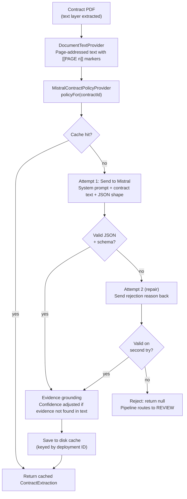

<!-- loio36082398abc24d5fbeb3bcb541c766c7 -->

# AI-Based Contract Extraction

AP Guardian uses Mistral on SAP AI Core to extract thirteen structured fields from contract PDFs, each carrying a confidence score, a verbatim evidence quote, a page number, and a clause reference. The extraction layer is the only component that uses a generative AI model for decision-critical outputs; all comparisons and decisions are deterministic.

<a name="loio36082398abc24d5fbeb3bcb541c766c7__section_schema"/>

## Extraction Schema

Mistral returns a strict JSON object validated against a Zod schema. The thirteen extracted fields are:

<table>
<tr>
<th valign="top">Field</th>
<th valign="top">Type</th>
<th valign="top">Description</th>
</tr>
<tr>
<td valign="top"><code>contractId</code></td>
<td valign="top">string</td>
<td valign="top">Identifier of the contract, e.g., <code>CNT-2026-014</code>.</td>
</tr>
<tr>
<td valign="top"><code>contractType</code></td>
<td valign="top"><code>MATERIAL</code> | <code>SERVICE</code> | <code>UNKNOWN</code></td>
<td valign="top">What the contract supplies. Drives tax code determination.</td>
</tr>
<tr>
<td valign="top"><code>unitPrice</code></td>
<td valign="top">Field\(number\)</td>
<td valign="top">Contract unit price. Critical field — below 0.85 confidence suppresses the price comparison.</td>
</tr>
<tr>
<td valign="top"><code>currency</code></td>
<td valign="top">Field\(string\)</td>
<td valign="top">Contract currency. Critical field. Normalized to ISO code (SAR, USD) via policy aliases.</td>
</tr>
<tr>
<td valign="top"><code>unitOfMeasure</code></td>
<td valign="top">Field\(string\)</td>
<td valign="top">Unit of measure. Normalized to SAP UoM codes (MT, DRM, PAL) including Arabic aliases.</td>
</tr>
<tr>
<td valign="top"><code>paymentTerms</code></td>
<td valign="top">Field\(string\)</td>
<td valign="top">Contract payment term. Normalized to SAP payment term codes (ZB30, ZB45, ZB60).</td>
</tr>
<tr>
<td valign="top"><code>incoterm</code></td>
<td valign="top">Field\(string\)</td>
<td valign="top">Delivery terms (EXW, FCA, DAP, etc.).</td>
</tr>
<tr>
<td valign="top"><code>validFrom</code></td>
<td valign="top">Field\(YYYY-MM-DD\)</td>
<td valign="top">Contract start date.</td>
</tr>
<tr>
<td valign="top"><code>validTo</code></td>
<td valign="top">Field\(YYYY-MM-DD\)</td>
<td valign="top">Contract end date.</td>
</tr>
<tr>
<td valign="top"><code>priceAdjustmentCapPercent</code></td>
<td valign="top">Field\(number | null\)</td>
<td valign="top"><strong>Critical field.</strong> Maximum price adjustment the contract permits. Null means the contract grants no adjustment latitude at all — which is itself a finding. Zero is treated as null \(no real contract states a nil tolerance\).</td>
</tr>
<tr>
<td valign="top"><code>vatRatePercent</code></td>
<td valign="top">Field\(number | null\)</td>
<td valign="top">VAT rate stated in the contract. Used for the VAT amount check. Null if the contract states no rate.</td>
</tr>
<tr>
<td valign="top"><code>quantityTolerancePercent</code></td>
<td valign="top">Field\(number | null\)</td>
<td valign="top">Quantity variance the contract permits. Null means none permitted. Zero is treated as null.</td>
</tr>
<tr>
<td valign="top"><code>taxTreatment</code></td>
<td valign="top">Field\(string\)</td>
<td valign="top">Tax treatment classification as stated in the contract \(RECOVERABLE, NON_RECOVERABLE, ZERO_RATED, UNKNOWN\). Used to corroborate contract type.</td>
</tr>
</table>

Each `Field` carries: `value`, `confidence` (0–1), `clauseRef` (clause label as it appears in the contract), `page`, and `evidence` (verbatim quote from the contract).

<a name="loio36082398abc24d5fbeb3bcb541c766c7__section_prompt"/>

## System Prompt Design

The model is given an explicit role and strict constraints:

-   **Role**: "You extract contract terms for an Accounts Payable verification system. You read documents. You do not decide anything."
-   **Null discipline**: "A value you invent becomes a wrong financial decision, while a value you leave null simply routes to a human. Null is always the safer error."
-   **Evidence discipline**: Every non-null value must be supported by a verbatim quote from ONE continuous passage in ONE location. Joining text from two locations is forbidden — the result reads as a quotation but appears nowhere, and a reviewer who searches the contract will not find it.
-   **Clause by meaning**: Clause numbering varies between agreements. The model locates clauses by meaning and reports the label it actually found — it does not assume tax is clause 8 or delivery is clause 6.
-   **priceAdjustmentCapPercent special rule**: A rate the clause explicitly disapplies is null, not the stated rate. The real example: *"Annual escalation of 3% applicable from Year 2 onwards. Not applicable to current contract year."* The correct answer is null, not 3. This is verified as the decisive difference between pattern matching and semantic reading.
-   **Temperature**: 0 (deterministic output).
-   **Max tokens**: 2,500.

<a name="loio36082398abc24d5fbeb3bcb541c766c7__section_flow"/>

## Extraction Flow

<a name="loio36082398abc24d5fbeb3bcb541c766c7__section_confidence"/>

## Confidence and Evidence Grounding

The confidence score from the model is adjusted by the **evidence grounding** step (`src/ai/evidence-grounding.ts`). If the evidence quote the model supplied cannot be found verbatim in the document text, the confidence is penalized. This guards against a model that quotes text it invented rather than text it read.

The adjusted confidence is what gates comparisons:
-   Critical fields below **0.85** → `EXTRACTION` discrepancy → human review
-   The price-adjustment cap is especially critical: an unread cap is indistinguishable from no cap; treating it as absent would block an invoice the contract actually permits.

> ### Note:  
> Confidence is not correctness — it is the model's own estimate, grounded against the actual document text. A low confidence routes the invoice to a human, which is the correct outcome for a document that could not be read reliably.

<a name="loio36082398abc24d5fbeb3bcb541c766c7__section_cache"/>

## Disk Cache

Reading 25 contracts live through SAP AI Core takes approximately 8 minutes. The extraction cache eliminates this on subsequent startups. Cache entries are keyed by **deployment ID** so stale entries from a different model version are automatically invalidated.

The cache is stored in `data/contract-policy.live.json`. The `AP_LIVE_CACHE` environment variable overrides this path. Set `cachePath` to `null` in the constructor for the live re-verification path, which must never return cached results.

<a name="loio36082398abc24d5fbeb3bcb541c766c7__section_normalization"/>

## Field Normalization

Models may return the same fact in different words. Normalization is handled in policy, not in the prompt:

<table>
<tr>
<th valign="top">Field</th>
<th valign="top">Normalization rule</th>
</tr>
<tr>
<td valign="top">Payment terms</td>
<td valign="top">Regex extracts SAP codes \(ZB30/ZB45/ZB60\). Net-days prose ("Net 30") maps to the corresponding code.</td>
</tr>
<tr>
<td valign="top">Currency</td>
<td valign="top">Aliases mapped: "SAUDI RIYAL" → SAR, "SR" → SAR, "US DOLLAR" → USD, "USD $" → USD.</td>
</tr>
<tr>
<td valign="top">Incoterm</td>
<td valign="top">Regex extracts three-letter code from prose. A contract may append the named place after the code.</td>
</tr>
<tr>
<td valign="top">Unit of measure</td>
<td valign="top">Arabic aliases normalized: "طن متري" → MT, "برميل" → DRM, "منصة" → PAL, etc.</td>
</tr>
</table>

**Related Information**  

[SAP AI Core](https://help.sap.com/docs/AI_CORE/2d6c5984063c40a59eda62f4a9135bee/d029a32c22fb45fbb607e6a2c48c8a0e.html)

[Privacy and Security](privacy-and-security-77cbf91.md)

[Policy Configuration](policy-configuration-ebd7cc7.md)

[Verification Pipeline](verification-pipeline-e493a6b.md)
