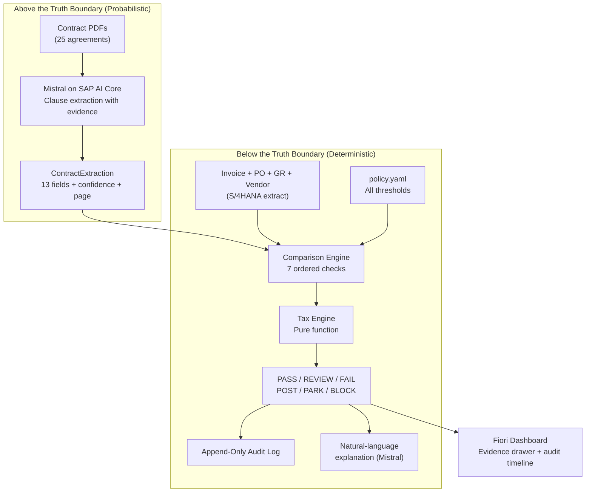

<!-- loioef47983a828d4bd198f8524ad5d036f4 -->

# AP Guardian

AP Guardian is an intelligent accounts payable invoice verification prototype for Nortech Steel, a Saudi steel manufacturer. It uses Mistral on SAP AI Core to extract contract clause values from PDF agreements, and deterministic TypeScript code to execute every comparison and produce every decision.

> ### Note:  
> AP Guardian was built as a SAP hackathon prototype for the topic **Intelligent Accounts Payable: Automating Invoice Verification & Tax Compliance**. It is a fully working system with 104 unit tests and a measured 97.9% weighted score across six judging criteria.

<a name="loioef47983a828d4bd198f8524ad5d036f4__section_design"/>

## The Central Design Idea

The central design principle of AP Guardian is captured in a single statement:

> **Probabilistic AI reads the contract. Deterministic code decides the invoice.**

There is a **truth boundary** in the architecture. Above it, Mistral reads documents and reports what it found with evidence. Below it, pure TypeScript produces every number, comparison, and decision. Facts cross downward; authority never crosses upward.

<a name="loioef47983a828d4bd198f8524ad5d036f4__section_why"/>

## Why the Split Exists

The rules are not hardcoded — they are written into each contract, in prose:

-   `CNT-2026-014` clause 3.3: *"Maximum +/- 10% per month"*
-   `CNT-2026-020` clause 3.3: *"Maximum +/- 8% per month"*
-   `CNT-2026-013`: no price-adjustment clause at all

Three contracts, three different rules for the same check. A hardcoded tolerance is wrong by construction, so a model is required to read them.

But the moment a model *decides*, the financial control stops being reproducible — and a hallucinated tax rate is invisible until an auditor finds it. Hence: the model reads, the code decides.

**What each side does:**

<table>
<tr>
<th valign="top">Mistral (Probabilistic)</th>
<th valign="top">Deterministic Code</th>
</tr>
<tr>
<td valign="top">Document understanding</td>
<td valign="top">Every comparison</td>
</tr>
<tr>
<td valign="top">Clause location (semantic, not by number)</td>
<td valign="top">All arithmetic</td>
</tr>
<tr>
<td valign="top">Field extraction with confidence and evidence</td>
<td valign="top">Tax determination</td>
</tr>
<tr>
<td valign="top">Writing the explanation, <em>after</em> the decision</td>
<td valign="top">Threshold evaluation</td>
</tr>
<tr>
<td valign="top">\-</td>
<td valign="top">PASS/REVIEW/FAIL and POST/PARK/BLOCK</td>
</tr>
</table>

<a name="loioef47983a828d4bd198f8524ad5d036f4__section_scope"/>

## Scope and Business Problem

**The business problem:** an AP accountant opens the contract PDF for every invoice, searches it for the price, payment-term, and Incoterm clauses, and compares them against the invoice, purchase order, and goods receipt by eye. This takes **15–20 minutes per invoice**. Standard SAP has no contract-clause extraction, so there is nothing off the shelf for it.

**Scope:** local material invoices (GR60) that reference a contract — one of Nortech's eight invoice types. This type was chosen because it is the highest-volume pain point and the pattern replicates to the other seven.

Nortech Steel is a Saudi manufacturer, so all vendor master data is Saudi and invoices are denominated in SAR. The contracts are in English (with 10 contracts also available in Arabic for the Arabic robustness demonstration).

<a name="loioef47983a828d4bd198f8524ad5d036f4__section_meta"/>

## Key Design Rules

Two meta-rules govern all decisions:

**Meta-rule A — Confidence threshold.** Any critical field read below **0.85 confidence** is not compared at all. It raises an `EXTRACTION` concern and routes to a human. Critical fields are: `unitPrice`, `currency`, `paymentTerms`, `contractType`, and `priceAdjustmentCapPercent`. Reporting a mismatch derived from a value the system admits it could not read is a false finding; the unread cap is especially dangerous because an unread cap is indistinguishable from no cap, and treating it as absent would block an invoice the contract actually permits.

**Meta-rule B — Block vs. Park.** Money faults block. Paperwork faults park. Price, tax code, and currency discrepancies stop the payment (Block). Payment terms, Incoterm, and validity discrepancies hold the document (Park). This distinction holds across all 13 FAIL cases in the scenario data and is asserted in test.

<a name="loioef47983a828d4bd198f8524ad5d036f4__section_results"/>

## Measured Results

Measured over all 30 test cases against the six weighted criteria from the organizers' Q&A:

<table>
<tr>
<th valign="top">Criterion</th>
<th valign="top">Weight</th>
<th valign="top">Score</th>
</tr>
<tr>
<td valign="top">Extraction accuracy</td>
<td valign="top">30%</td>
<td valign="top">98.1%</td>
</tr>
<tr>
<td valign="top">Discrepancy detection</td>
<td valign="top">25%</td>
<td valign="top">93.8% \(15/16\)</td>
</tr>
<tr>
<td valign="top">Tax determination</td>
<td valign="top">20%</td>
<td valign="top">100% \(30/30\)</td>
</tr>
<tr>
<td valign="top">Processing time</td>
<td valign="top">10%</td>
<td valign="top">100% \(p50 15s vs. 35s target\)</td>
</tr>
<tr>
<td valign="top">Explainability and audit</td>
<td valign="top">10%</td>
<td valign="top">100%</td>
</tr>
<tr>
<td valign="top">False positive rate</td>
<td valign="top">5%</td>
<td valign="top">100% \(0 of 15 clean flagged\)</td>
</tr>
<tr>
<td valign="top"><strong>Weighted total</strong></td>
<td valign="top">\-</td>
<td valign="top"><strong>97.9%</strong></td>
</tr>
<tr>
<td valign="top"><strong>Decision accuracy</strong></td>
<td valign="top">\-</td>
<td valign="top"><strong>100%</strong> — decision and action, all 30</td>
</tr>
</table>

All three frontier models tested (Mistral Medium 3.5, GPT-4o, Claude 4.5 Sonnet) achieved identical accuracy. Extraction quality is not the differentiator — the deterministic layer carries the score. This means choosing Mistral for privacy costs nothing in accuracy.

<a name="loioef47983a828d4bd198f8524ad5d036f4__section_not"/>

## What AP Guardian Is Not

AP Guardian is not a payment system, not an S/4HANA clone, and not a ZATCA engine. It recommends an action; it does not execute it. Write-back to S/4HANA via `API_SUPPLIERINVOICE_PROCESS_SRV` is the intended production path but is not implemented in this prototype.

**Related Information**  

[SAP AI Core](https://help.sap.com/docs/AI_CORE/2d6c5984063c40a59eda62f4a9135bee/d029a32c22fb45fbb607e6a2c48c8a0e.html)

[AI-Assisted Goods Receipt Analysis](https://help.sap.com/docs/SAP_S4HANA_ON-PREMISE/e3dc5400c1cc41d1bc0ae0e7fd9aa5a2/30d87325d6964ec18da12bd2fe927009.html)

[Architecture and Components](architecture-and-components-569c834.md)

[Verification Pipeline](verification-pipeline-e493a6b.md)
