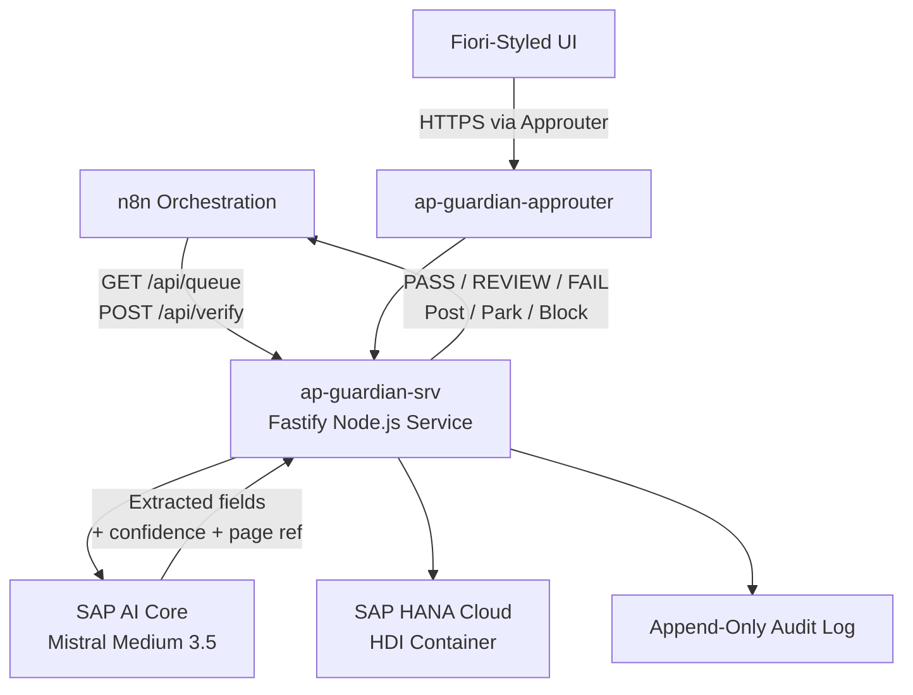

<!-- loio5d8a8f93906c46baa1f7455a91c5f324 -->

# System Architecture

AP Guardian is built on SAP Business Technology Platform \(SAP BTP\) using the Cloud Foundry runtime. The system decomposes into a set of focused modules that together implement the truth-boundary design: a probabilistic AI extraction layer above and a deterministic decision engine below. This document describes each component, the data flow through the pipeline, and the BTP services the system depends on.

<a name="loio5d8a8f93906c46baa1f7455a91c5f324__section_architecture_overview"/>

## Architecture Overview

The diagram below illustrates the runtime topology. Invoice data flows in from the n8n orchestration layer, passes through the contract extractor \(which calls SAP AI Core\), and arrives at the deterministic comparison and decision engine. All data at rest is stored in SAP HANA Cloud.

<a name="loio5d8a8f93906c46baa1f7455a91c5f324__section_components"/>

## System Components

**AP Guardian System Components**

<table>
<tr>
<th valign="top">

Module

</th>
<th valign="top">

Responsibility

</th>
<th valign="top">

Technology

</th>
</tr>
<tr>
<td valign="top">

`src/ai/sap-aicore-mistral-service.ts`

</td>
<td valign="top">

The only route to any AI model. Manages cached OAuth tokens, supports both chat-completions and Anthropic-messages API shapes. Refuses to construct against any non-SAP AI Core endpoint, including localhost.

</td>
<td valign="top">

SAP AI Core, Mistral Medium 3.5

</td>
</tr>
<tr>
<td valign="top">

`src/ai/contract-extractor.ts`

</td>
<td valign="top">

Sends the contract text to Mistral, validates the response against a strict Zod schema, attempts one repair retry, then rejects rather than coerces. Results are disk-cached by deployment ID.

</td>
<td valign="top">

TypeScript, Zod

</td>
</tr>
<tr>
<td valign="top">

`src/ai/explanation-writer.ts`

</td>
<td valign="top">

Generates natural-language explanations from the computed result after the decision is made. Includes a contradiction guard. Vendor numbers are redacted from every prompt.

</td>
<td valign="top">

SAP AI Core, TypeScript

</td>
</tr>
<tr>
<td valign="top">

`src/engine/comparison-engine.ts`

</td>
<td valign="top">

Runs the seven verification checks in their mandatory order with currency gating and per-contract price caps. Produces the structured decision result.

</td>
<td valign="top">

TypeScript \(pure, no I/O\)

</td>
</tr>
<tr>
<td valign="top">

`src/engine/tax-engine.ts`

</td>
<td valign="top">

Pure function deriving the expected tax code from contract type and vendor tax status. No I/O, no model call, no clock dependency.

</td>
<td valign="top">

TypeScript

</td>
</tr>
<tr>
<td valign="top">

`src/policy/policy.yaml`

</td>
<td valign="top">

Contains every numeric threshold in the system: tax matrix, confidence minimum, severity map, action map, and normalization rules. A numeric literal anywhere else in `src/` is a bug.

</td>
<td valign="top">

YAML

</td>
</tr>
<tr>
<td valign="top">

`src/data/dataset.ts`

</td>
<td valign="top">

Loads the workbook, resolves the invoice → PO → GR → vendor → contract chain. Cell references are addressed by name, not position, so service POs with blank Incoterm columns do not shift subsequent fields.

</td>
<td valign="top">

TypeScript, dependency-free XLSX reader

</td>
</tr>
<tr>
<td valign="top">

`src/documents/document-text-provider.ts`

</td>
<td valign="top">

Provides page-addressed contract text using `[[PAGE n]]` markers. Language is detected from content. SAP Document Information Extraction slots in behind this interface for scanned documents.

</td>
<td valign="top">

TypeScript interface, pdfjs-dist

</td>
</tr>
<tr>
<td valign="top">

`src/audit/audit-log.ts`

</td>
<td valign="top">

Append-only by construction — no update or delete methods exist. Logs correlation ID, policy version, model deployment ID, and confidence per event. No document content is written to any log line.

</td>
<td valign="top">

TypeScript

</td>
</tr>
<tr>
<td valign="top">

`src/api/server.ts`

</td>
<td valign="top">

Fastify HTTP server that exposes the verification REST API and serves the Fiori-styled dashboard \(SAP Horizon design language, UI5 Web Components\).

</td>
<td valign="top">

Fastify 5, Node.js ≥ 20

</td>
</tr>
<tr>
<td valign="top">

`n8n/`

</td>
<td valign="top">

Orchestration workflow that handles invoice intake, calls the verification service, and routes each outcome to the correct SAP action \(MIRO for Post, MIR7 for Park, MRBR for Block\).

</td>
<td valign="top">

n8n \(or SAP Build Process Automation\)

</td>
</tr>
</table>

<a name="loio5d8a8f93906c46baa1f7455a91c5f324__section_btp_services"/>

## SAP BTP Services

The following SAP BTP services are bound to the application at runtime via `mta.yaml`:

**BTP Service Bindings**

<table>
<tr>
<th valign="top">

Service Name

</th>
<th valign="top">

BTP Service

</th>
<th valign="top">

Plan

</th>
<th valign="top">

Purpose

</th>
</tr>
<tr>
<td valign="top">

`ap-guardian-aicore`

</td>
<td valign="top">

SAP AI Core

</td>
<td valign="top">

Existing service instance

</td>
<td valign="top">

Provides the Mistral model deployment endpoint and OAuth credentials.

</td>
</tr>
<tr>
<td valign="top">

`ap-guardian-db`

</td>
<td valign="top">

SAP HANA Cloud

</td>
<td valign="top">

`hdi-shared`

</td>
<td valign="top">

Stores Nortech master data, transactional data, and the audit log.

</td>
</tr>
<tr>
<td valign="top">

`ap-guardian-uaa`

</td>
<td valign="top">

SAP Authorization and Trust Management \(XSUAA\)

</td>
<td valign="top">

`application`

</td>
<td valign="top">

Secures the API and UI with OAuth 2.0 and tenant-mode dedicated isolation.

</td>
</tr>
<tr>
<td valign="top">

`ap-guardian-html5-repo-host`

</td>
<td valign="top">

HTML5 Application Repository

</td>
<td valign="top">

`app-host`

</td>
<td valign="top">

Hosts the Fiori UI static assets.

</td>
</tr>
<tr>
<td valign="top">

`ap-guardian-destination`

</td>
<td valign="top">

SAP BTP Destination Service

</td>
<td valign="top">

`lite`

</td>
<td valign="top">

Routes traffic from the approuter to the verification service backend with HTML5Runtime enabled.

</td>
</tr>
</table>

<a name="loio5d8a8f93906c46baa1f7455a91c5f324__section_data_flow"/>

## Data Flow

The verification pipeline processes one invoice through the following stages:

1.  n8n calls `GET /api/queue` to retrieve invoices pending verification.
2.  For each invoice, n8n calls `POST /api/verify` with the invoice identifier.
3.  The verification service loads the invoice, PO, GR, vendor master, and contract from SAP HANA Cloud via `src/data/dataset.ts`.
4.  `src/documents/document-text-provider.ts` loads the contract PDF text with page markers.
5.  `src/ai/contract-extractor.ts` sends the contract text to Mistral via SAP AI Core and validates the structured extraction result against a Zod schema.
6.  Any critical field extracted below 0.85 confidence is flagged as an `EXTRACTION` concern and routed to a human reviewer without running the downstream checks.
7.  `src/engine/comparison-engine.ts` runs the seven checks in order using only the extracted fields and the structured invoice data.
8.  `src/engine/tax-engine.ts` derives the expected tax code as a pure function.
9.  The result \(PASS / REVIEW / FAIL + Post / Park / Block\) is returned to n8n.
10.  `src/ai/explanation-writer.ts` generates the natural-language summary after the decision is finalized.
11.  `src/audit/audit-log.ts` appends an immutable log record.

<a name="loio5d8a8f93906c46baa1f7455a91c5f324__section_related"/>

**Related Information**  

[AP Guardian Overview](ap-guardian-overview-017966c.md)

[Configuration and Deployment](configuration-and-deployment-84479ca.md)

[SAP AI Core Models](https://help.sap.com/docs/AI_CORE/d5d03749687449ad9768e46ea9e32b1e/6440777c196642dbb3171aa5c37b987e.html "Access and manage AI models available on SAP AI Core infrastructure.") :arrow_upper_right:

[SAP Document AI Extraction](https://help.sap.com/docs/SAP_DOCUMENT_AI/5fa7265b9ff64d73bac7cec61ee55ae6/f1c1681edfcd491e84f2d811e48cfcce.html)
