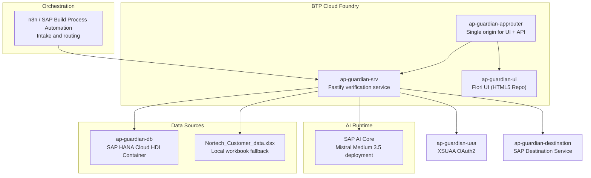

<!-- loio569c834b96db403a8108b3dc1216dea0 -->

# Architecture and Components

AP Guardian is composed of eleven modules organized into a **probabilistic extraction layer** above the truth boundary and a **deterministic decision layer** below it. This document describes each module, the BTP deployment topology, and the runtime data sources.

<a name="loio569c834b96db403a8108b3dc1216dea0__section_overview"/>

## System Architecture

<a name="loio569c834b96db403a8108b3dc1216dea0__section_modules"/>

## Module Reference

**Eleven modules**, each with a single responsibility:

<table>
<tr>
<th valign="top">Module</th>
<th valign="top">Responsibility</th>
</tr>
<tr>
<td valign="top"><code>src/data/dataset.ts</code></td>
<td valign="top">Loads the workbook, resolves invoice → PO → GR → vendor → contract attachment chain.</td>
</tr>
<tr>
<td valign="top"><code>src/data/xlsx.ts</code> + <code>zip.ts</code></td>
<td valign="top">Dependency-free XLSX reader. Cells are addressed <strong>by reference, not position</strong> — service POs leave the Incoterm column blank, so a positional parse shifts every later column.</td>
</tr>
<tr>
<td valign="top"><code>src/data/table.ts</code></td>
<td valign="top">Finds the header row by content, maps header text to column letter, and fails loudly on schema drift.</td>
</tr>
<tr>
<td valign="top"><code>src/documents/document-text-provider.ts</code></td>
<td valign="top">Page-addressed contract text with <code>[[PAGE n]]</code> markers. OCR and SAP Document Information Extraction slot in behind this interface without touching anything downstream.</td>
</tr>
<tr>
<td valign="top"><code>src/ai/sap-aicore-mistral-service.ts</code></td>
<td valign="top">The only route to a model. Cached OAuth token, handles both chat-completions and Anthropic-messages API shapes. <strong>Refuses to construct against a non-AI-Core endpoint</strong>, including localhost.</td>
</tr>
<tr>
<td valign="top"><code>src/ai/contract-extractor.ts</code></td>
<td valign="top">Sends the contract to Mistral, validates against a strict Zod schema, one repair retry, then rejects rather than coerces. Disk cache keyed by deployment ID.</td>
</tr>
<tr>
<td valign="top"><code>src/ai/explanation-writer.ts</code></td>
<td valign="top">Writes natural-language prose from the computed result. Contradiction guard prevents the model from claiming a different outcome than the deterministic layer computed. Vendor numbers are redacted from the prompt.</td>
</tr>
<tr>
<td valign="top"><code>src/policy/policy.yaml</code></td>
<td valign="top"><strong>Every threshold in the system.</strong> Tax matrix, confidence minimum, severity map, action map, normalization rules. A numeric literal anywhere else in <code>src/</code> is a bug.</td>
</tr>
<tr>
<td valign="top"><code>src/engine/tax-engine.ts</code></td>
<td valign="top">Pure function: contract type × vendor status → tax code. No I/O, no clock, no model call.</td>
</tr>
<tr>
<td valign="top"><code>src/engine/comparison-engine.ts</code></td>
<td valign="top">The seven verification checks, in a load-bearing order, with currency gating and per-contract price caps.</td>
</tr>
<tr>
<td valign="top"><code>src/engine/adjustment-reference.ts</code></td>
<td valign="top">Detects whether the invoice text documents a price adjustment. Consulted <strong>only after</strong> the contract-side price gates have fired.</td>
</tr>
<tr>
<td valign="top"><code>src/audit/audit-log.ts</code></td>
<td valign="top">Append-only by construction. No update method, no delete method.</td>
</tr>
<tr>
<td valign="top"><code>src/eval/harness.ts</code> + <code>scorecard.ts</code></td>
<td valign="top">Scores all six judging criteria; swaps verifiers with one argument (<code>null</code>, <code>pipeline</code>, or <code>mistral</code>).</td>
</tr>
<tr>
<td valign="top"><code>src/api/server.ts</code></td>
<td valign="top">Fastify API and static file server for the Fiori-styled UI.</td>
</tr>
<tr>
<td valign="top"><code>n8n/</code></td>
<td valign="top">Five orchestration workflows: intake, exception handling, approval, monitoring, escalation.</td>
</tr>
</table>

<a name="loio569c834b96db403a8108b3dc1216dea0__section_data"/>

## Data Sources

AP Guardian supports two runtime data sources, controlled by the `AP_DATA` environment variable:

<table>
<tr>
<th valign="top">Source</th>
<th valign="top"><code>AP_DATA</code> value</th>
<th valign="top">When used</th>
</tr>
<tr>
<td valign="top">SAP HANA Cloud \(HDI container\)</td>
<td valign="top"><code>hana</code></td>
<td valign="top">Default on Cloud Foundry \(<code>VCAP_SERVICES</code> present\). Reads live from the <code>APG_*</code> tables.</td>
</tr>
<tr>
<td valign="top">XLSX workbook</td>
<td valign="top">any other value</td>
<td valign="top">Default locally. Reads <code>data/Nortech_Customer_data.xlsx</code>.</td>
</tr>
</table>

Both paths produce the same `Dataset` object graph, so this choice cannot change a verification outcome — it only changes where the facts came from.

<a name="loio569c834b96db403a8108b3dc1216dea0__section_provider"/>

## AI Provider Modes

The contract extraction provider is controlled by the `AP_PROVIDER` environment variable:

<table>
<tr>
<th valign="top">Provider</th>
<th valign="top"><code>AP_PROVIDER</code></th>
<th valign="top">Behavior</th>
<th valign="top">Network required</th>
</tr>
<tr>
<td valign="top">Fixture \(default\)</td>
<td valign="top"><code>fixture</code> or unset</td>
<td valign="top">Replays pre-read contract policy from <code>data/contract-policy.json</code>. Startup in ~2s.</td>
<td valign="top">No</td>
</tr>
<tr>
<td valign="top">Mistral live</td>
<td valign="top"><code>mistral</code></td>
<td valign="top">Reads every contract through SAP AI Core. First run takes ~8 minutes; results are cached to <code>data/contract-policy.live.json</code>.</td>
<td valign="top">Yes \(SAP AI Core\)</td>
</tr>
</table>

> ### Tip:  
> Use `AP_PROVIDER=fixture` for development and test runs. Use `AP_PROVIDER=mistral` to demonstrate live extraction or to regenerate the extraction cache.

<a name="loio569c834b96db403a8108b3dc1216dea0__section_btp"/>

## BTP Deployment Topology

The `mta.yaml` defines five modules and six resources on SAP BTP Cloud Foundry:

**Modules:**

<table>
<tr>
<th valign="top">Module</th>
<th valign="top">Type</th>
<th valign="top">Description</th>
</tr>
<tr>
<td valign="top"><code>ap-guardian-srv</code></td>
<td valign="top">nodejs</td>
<td valign="top">The verification service. 512M memory, 1024M disk. The only component that reads contracts or decides invoices.</td>
</tr>
<tr>
<td valign="top"><code>ap-guardian-db-deployer</code></td>
<td valign="top">hdb</td>
<td valign="top">Deploys the five HANA table definitions to the HDI container.</td>
</tr>
<tr>
<td valign="top"><code>ap-guardian-ui</code></td>
<td valign="top">html5</td>
<td valign="top">Fiori application built by UI5 tooling, deployed to the HTML5 repository.</td>
</tr>
<tr>
<td valign="top"><code>ap-guardian-ui-deployer</code></td>
<td valign="top">com.sap.application.content</td>
<td valign="top">Copies the UI build artifact to the HTML5 repository host.</td>
</tr>
<tr>
<td valign="top"><code>ap-guardian-approuter</code></td>
<td valign="top">approuter.nodejs</td>
<td valign="top">Single-origin approuter. 256M memory. Routes <code>/api/*</code> to the verification service and serves the UI from the HTML5 repository. Eliminates CORS by design.</td>
</tr>
</table>

**Resources:**

<table>
<tr>
<th valign="top">Resource</th>
<th valign="top">Type</th>
<th valign="top">Description</th>
</tr>
<tr>
<td valign="top"><code>ap-guardian-db</code></td>
<td valign="top">com.sap.xs.hdi-container</td>
<td valign="top">SAP HANA Cloud HDI container, <code>hdi-shared</code> service plan.</td>
</tr>
<tr>
<td valign="top"><code>ap-guardian-uaa</code></td>
<td valign="top">org.cloudfoundry.managed-service \(xsuaa\)</td>
<td valign="top">XSUAA with <code>APAccountant</code> and <code>APSupervisor</code> role templates. Reads <code>xs-security.json</code>.</td>
</tr>
<tr>
<td valign="top"><code>ap-guardian-html5-repo-host</code></td>
<td valign="top">html5-apps-repo \(app-host\)</td>
<td valign="top">Hosts the built UI assets.</td>
</tr>
<tr>
<td valign="top"><code>ap-guardian-html5-repo-rt</code></td>
<td valign="top">html5-apps-repo \(app-runtime\)</td>
<td valign="top">Runtime service for the HTML5 repository.</td>
</tr>
<tr>
<td valign="top"><code>ap-guardian-aicore</code></td>
<td valign="top">org.cloudfoundry.existing-service</td>
<td valign="top">An existing SAP AI Core service instance. Declared as existing because the credentials may predate this project and the entitlement may sit in a different subaccount.</td>
</tr>
<tr>
<td valign="top"><code>ap-guardian-destination</code></td>
<td valign="top">org.cloudfoundry.managed-service \(destination\)</td>
<td valign="top">SAP Destination Service, lite plan. <code>HTML5Runtime_enabled: true</code>.</td>
</tr>
</table>

**Related Information**  

[Maintaining the Multitarget Application Development and Deployment Descriptors](https://help.sap.com/docs/HANA_CLOUD_DATABASE/c2b99f19e9264c4d9ae9221b22f6f589/b2e355a5137c4799932f776716b292c9.html)

[Setting Up a Schema or an HDI Container](https://help.sap.com/docs/HANA_CLOUD_CN/57175c34172a4f73b765f95f899c0094/2863434ddda042b8b8011a3f24856281.html)

[Deployment Guide](deployment-guide-5c317ac.md)

[AP Guardian Overview](ap-guardian-overview-ef47983.md)
