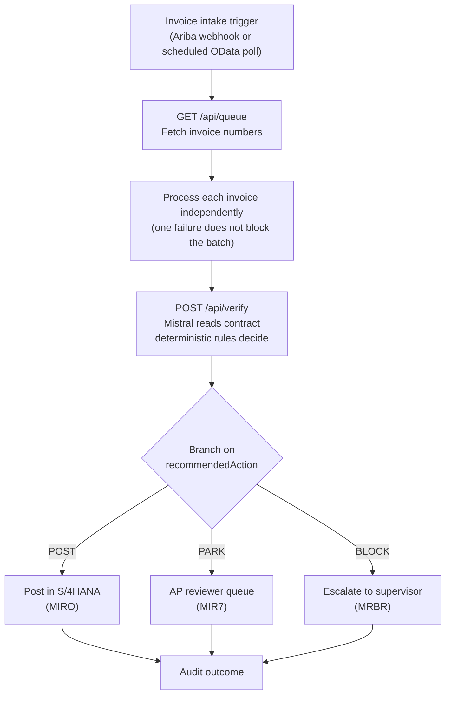

<!-- loio668d71a2398e49d58ec5132dab0f2358 -->

# Orchestration Workflows

AP Guardian includes five n8n workflow definitions that implement the intake, exception handling, approval, monitoring, and escalation processes. The workflow layer sits **around** the verification service, not inside it — it handles routing, not deciding.


<a name="loio668d71a2398e49d58ec5132dab0f2358__section_design"/>

## Design Principle

The split between orchestration and verification is deliberate:

> A workflow node computing a VAT code cannot be diffed in a pull request, cannot be unit-tested, and cannot tell an auditor which version of a rule produced a posting last March.

The service computes the decision; the workflow routes on the result. This keeps the verifiable, auditable logic inside the TypeScript service where it can be tested and versioned.


<a name="loio668d71a2398e49d58ec5132dab0f2358__section_flow"/>

## Intake Workflow Flow



The three branches mirror the meta-rule: **money faults block, paperwork faults park**.


<a name="loio668d71a2398e49d58ec5132dab0f2358__section_workflows"/>

## Five Workflow Files

<table>
<tr>
<th valign="top">File</th>
<th valign="top">Purpose</th>
</tr>
<tr>
<td valign="top"><code>ap-guardian-1-intake.json</code></td>
<td valign="top">Main intake: polls the queue, verifies each invoice, routes to Post/Park/Block.</td>
</tr>
<tr>
<td valign="top"><code>ap-guardian-2-exception.json</code></td>
<td valign="top">Exception handling: re-processes invoices that failed with an unexpected error (network timeout, model unavailable).</td>
</tr>
<tr>
<td valign="top"><code>ap-guardian-3-approval.json</code></td>
<td valign="top">Approval workflow: when an invoice is parked or blocked, routes to the appropriate approver and records the human review event.</td>
</tr>
<tr>
<td valign="top"><code>ap-guardian-4-monitor.json</code></td>
<td valign="top">Monitoring: periodically checks queue depth, error rates, and verification latency.</td>
</tr>
<tr>
<td valign="top"><code>ap-guardian-5-escalation.json</code></td>
<td valign="top">Escalation: invokes supervisor approval for high-priority blocked invoices.</td>
</tr>
</table>


<a name="loio668d71a2398e49d58ec5132dab0f2358__section_endpoints"/>

## Endpoints the Workflow Uses

<table>
<tr>
<th valign="top">Method</th>
<th valign="top">Path</th>
<th valign="top">Returns</th>
</tr>
<tr>
<td valign="top">GET</td>
<td valign="top"><code>/api/queue</code></td>
<td valign="top">Invoice numbers awaiting verification.</td>
</tr>
<tr>
<td valign="top">POST</td>
<td valign="top"><code>/api/verify</code></td>
<td valign="top">Decision, action, discrepancies, exposure, explanation. Flat <code>shouldPost</code> / <code>shouldPark</code> / <code>shouldBlock</code> booleans for direct branching.</td>
</tr>
</table>


<a name="loio668d71a2398e49d58ec5132dab0f2358__section_running"/>

## Running n8n Locally

**Step 1 — Start the verification service:**

```sh
npx tsx src/api/server.ts                        # cached replay, ~2s, offline
AP_PROVIDER=mistral npx tsx src/api/server.ts   # live Mistral, ~80s startup
```

**Step 2 — Start n8n:**

```sh
n8n start
```

n8n serves its editor at `http://localhost:5678` and stores workflows in a local SQLite database under `~/.n8n`. Community Edition, self-hosted — no account, no API key.

**Step 3 — Import the workflow:** in the n8n editor, choose *Workflows → Import from File* and select `n8n/ap-guardian-1-intake.json`.

**Step 4 — Run:** open the workflow and choose *Test workflow*. Each node shows its input and output — the routing decision per invoice is visible on the canvas.


<a name="loio668d71a2398e49d58ec5132dab0f2358__section_production"/>

## Production Landscape

In a BTP deployment, the orchestration layer would be **SAP Build Process Automation**, which integrates with S/4HANA workflow and the Fiori inbox natively. The verification service is orchestrator-agnostic — anything that can POST can drive it.

-   **Trigger** becomes an Ariba webhook or a scheduled poll of `API_SUPPLIERINVOICE_PROCESS_SRV`.
-   **Post / Park / Block** become OData calls against the same service, or SAP Build Process Automation tasks for the approval steps.

**Related Information**  


[REST API Reference](api-reference-c4925c5.md)

[Deployment Guide](deployment-guide-5c317ac.md)

[Verification Pipeline](verification-pipeline-e493a6b.md)
