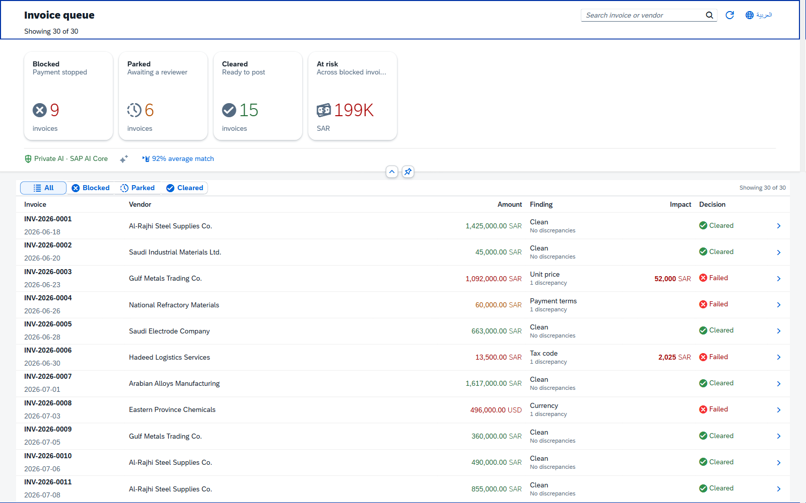
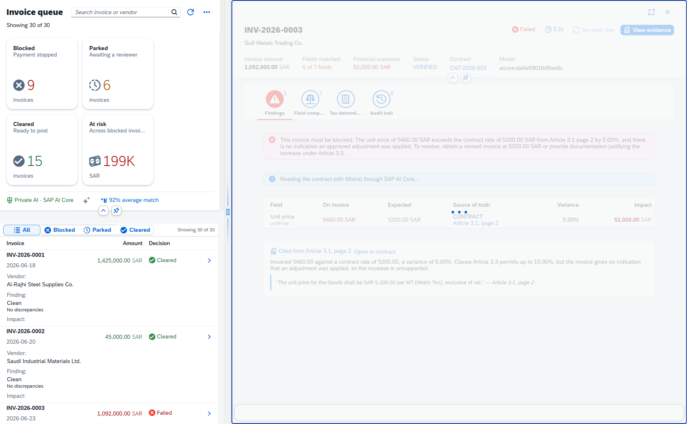
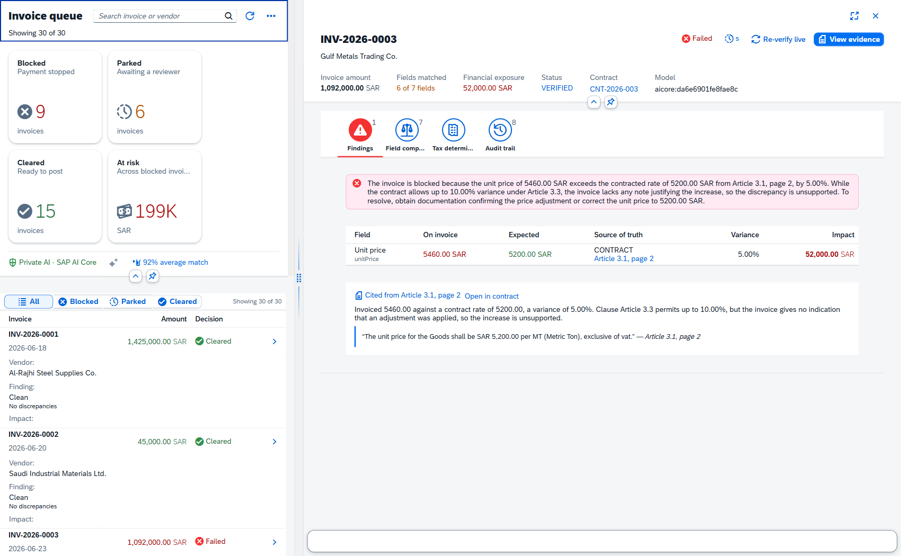
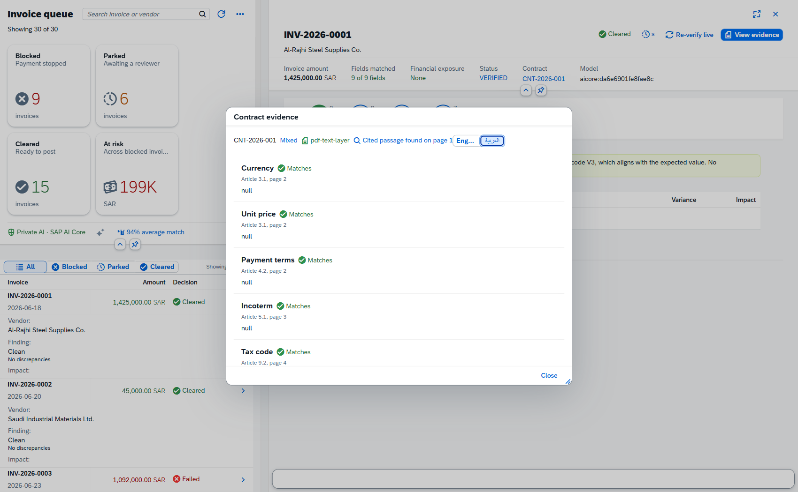
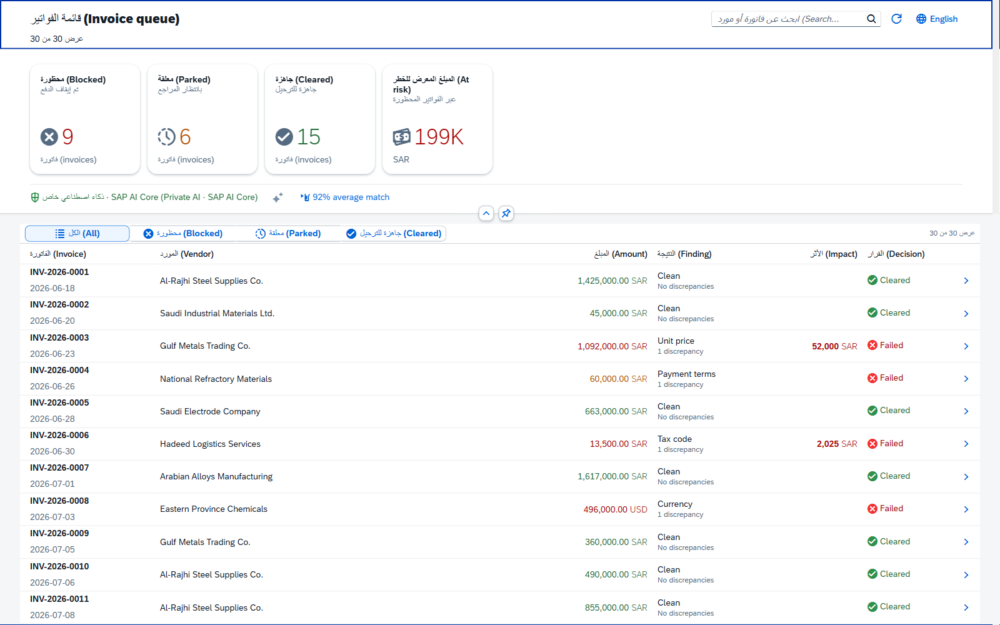
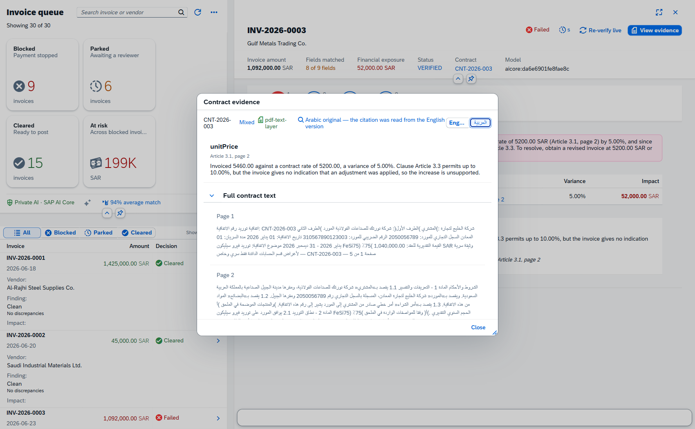
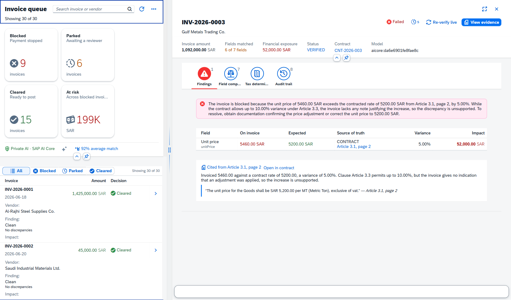

<!-- loio8c05c24e2bea4dfa8b047d5e53c5fa0e -->

# UI Dashboard

AP Guardian includes a Fiori-styled invoice verification dashboard that shows the full verification output for every invoice: the decision, discrepancies, evidence citations, audit timeline, and privacy statement. The dashboard is built with hand-authored HTML/CSS using the SAP Horizon design language and UI5 Web Components.

<a name="loio8c05c24e2bea4dfa8b047d5e53c5fa0e__section_overview"/>

## Dashboard Overview

The main dashboard shows all 30 invoices with their verification status, financial exposure, and discrepancy summary. A natural-language query box re-renders the queue based on the question.

<a name="loio8c05c24e2bea4dfa8b047d5e53c5fa0e__section_detail"/>

## Invoice Detail View

The detail view shows a single invoice with:

-   Decision badge (PASS / REVIEW / FAIL) and recommended action (POST / PARK / BLOCK)
-   Financial exposure in SAR
-   Discrepancies table with field, invoice value, expected value, source of truth, clause reference, and page
-   Observations (reported but non-decisive findings)
-   Natural-language explanation generated by Mistral

<a name="loio8c05c24e2bea4dfa8b047d5e53c5fa0e__section_evidence"/>

## Evidence Drawer

For each discrepancy, the evidence drawer shows the verbatim contract clause the AI read, the page it came from, and the clause reference. A reviewer can check the citation against the actual contract text without trusting the model's claim.

The drawer for a clean \(PASS\) invoice shows the evidence the model found that confirmed the values matched:

<a name="loio8c05c24e2bea4dfa8b047d5e53c5fa0e__section_arabic"/>

## Arabic Contract Support

Where the organizers supplied Arabic versions of a contract, the dashboard shows an Arabic/English toggle. The Arabic text was read by the same Mistral extraction pipeline — the same clause, the same confidence score, the same evidence mechanism. The UI renders the Arabic clause beside the English translation so a reviewer who does not read Arabic can still check the sentence a payment was blocked on.

The translation is for presentation only. It is computed by Mistral after the decision. A flawed translation cannot change an outcome.

<a name="loio8c05c24e2bea4dfa8b047d5e53c5fa0e__section_reverify"/>

## Live Re-Verification

The *Re-verify* button re-reads the contract through SAP AI Core with no cache. The response shows:

-   Whether the decision changed from the cached result
-   Which model deployment answered
-   The lowest field confidence in this reading
-   Actual elapsed time in milliseconds

This demonstrates that the extraction is reproducible, not cached from a single run.

<a name="loio8c05c24e2bea4dfa8b047d5e53c5fa0e__section_query"/>

## Natural-Language Query

The query box accepts natural-language questions about the invoice queue. The model returns a **filter**, not an answer — the displayed invoices, count, and exposure are computed from the same verified results the full dashboard uses.

Example queries:

-   *"Show me all invoices with tax code discrepancies"*
-   *"Which invoices are blocked?"*
-   *"What is the total exposure for price discrepancies?"*

If the model cannot parse the question into a valid filter, the response is a 422 error — not an empty result, not all invoices. A silent return-all would look like an answer.

<a name="loio8c05c24e2bea4dfa8b047d5e53c5fa0e__section_privacy"/>

## Privacy Panel

The privacy panel renders the response from `/api/privacy` — a computed statement of what the architecture can actually prove, not a marketing claim. It shows the runtime model host, number of public LLM calls (0), data minimization policy, and audit event count.

> ### Note:  
> The dashboard is hand-built using the SAP Horizon design language and UI5 Web Components (`@ui5/webcomponents`). It is not a full SAP UI5 application. For production, replace the web UI with a proper UI5 application connected to the same REST API.

**Related Information**  

[REST API Reference](api-reference-c4925c5.md)

[Privacy and Security](privacy-and-security-77cbf91.md)

[AI-Based Contract Extraction](ai-contract-extraction-3608239.md)
