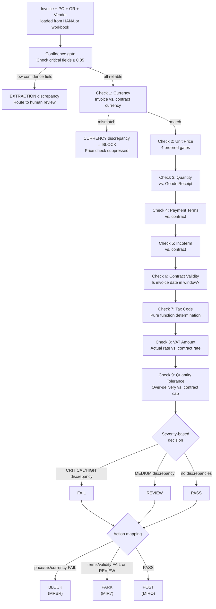

<!-- loioe493a6b189d84c5896f33beaf2032079 -->

# Verification Pipeline

The AP Guardian verification pipeline runs seven ordered checks against every invoice, using extracted contract values, purchase order data, goods receipt quantities, and vendor master records to determine whether to post, park, or block the document.

> ### Caution:  
> The order of the seven checks is load-bearing, not stylistic. Reordering the price gates breaks two specific test cases and three tests exist solely to catch that reordering. Do not change the check sequence.

<a name="loioe493a6b189d84c5896f33beaf2032079__section_flow"/>

## Pipeline Flow

<a name="loioe493a6b189d84c5896f33beaf2032079__section_checks"/>

## The Seven Checks

**Check 1 — Currency**

Invoice currency vs. contract currency. Runs **first** because comparing USD 3,306 to SAR 3,200 produces a meaningless variance. On mismatch the price check is *suppressed* and recorded as "not comparable". Currency mismatch severity is CRITICAL → BLOCK.

**Check 2 — Unit Price (four gates, order is load-bearing)**

<table>
<tr>
<th valign="top">Gate</th>
<th valign="top">Condition</th>
<th valign="top">Outcome</th>
</tr>
<tr>
<td valign="top">1</td>
<td valign="top">Contract states <strong>no price-adjustment clause</strong></td>
<td valign="top">FAIL</td>
</tr>
<tr>
<td valign="top">2</td>
<td valign="top">Variance <strong>exceeds that contract's stated cap</strong></td>
<td valign="top">FAIL</td>
</tr>
<tr>
<td valign="top">3</td>
<td valign="top">Within cap <strong>and</strong> invoice text documents an adjustment</td>
<td valign="top">REVIEW</td>
</tr>
<tr>
<td valign="top">4</td>
<td valign="top">Within cap, <strong>undocumented</strong></td>
<td valign="top">FAIL</td>
</tr>
</table>

Gates 1 and 2 must run before gate 3. The dataset contains two traps:
-   `TC-18` invoice text says *"Q3-2026"* — that is a **period**, not a price adjustment. Safe only because its contract has no cap clause (gate 1 fires first).
-   `TC-26` says *"price adjusted"* — genuine, but it must **not** rescue a 10.87% variance against an 8% cap (gate 2 fires first).

Unit price discrepancy severity is CRITICAL → BLOCK.

**Check 3 — Quantity**

Invoice quantity vs. **goods receipt** quantity. The PO quantity is a planning figure; the GR records what physically arrived. Invoicing 52 MT against a PO of 51 is correct when the GR confirms 52. Source of truth: `GOODS_RECEIPT`. Quantity discrepancy severity is HIGH → PARK.

**Check 4 — Payment Terms**

Invoice payment term vs. contract term (SAP codes `ZB30`, `ZB45`, `ZB60`). The comparison normalizes both sides through the policy normalization rules so a model returning "Net 30 days" matches a PO with `ZB30`. Payment terms discrepancy severity is HIGH → PARK.

**Check 5 — Incoterm**

Delivery terms vs. contract Incoterm (three-letter codes: EXW, FCA, DAP, etc.). The comparison uses the PO Incoterm as the invoice-side value since invoices do not carry a separate Incoterm field. Incoterm discrepancy severity is HIGH → PARK.

**Check 6 — Contract Validity**

Is the invoice date inside the contract's validity window (`validFrom` to `validTo`)? Contract validity discrepancy severity is MEDIUM → PARK.

**Check 7 — Tax Code**

The expected tax code is determined by a pure function from contract type and vendor tax status (see [Tax Code Determination](tax-determination-f240e83.md)). The result is compared against the tax code on the invoice. `UNKNOWN` never counts as a match — an undetermined code must route to review rather than quietly agreeing with whatever the vendor wrote. Tax code discrepancy severity is CRITICAL → BLOCK.

**Check 8 — VAT Amount**

The tax-code check confirms the correct code was applied. It says nothing about the amount. A correct code with a wrong amount is money leaving the company with the paperwork in order. Where the contract states a VAT rate, the actual tax amount is compared against the expected amount at that rate. Tolerance is **0.25 percentage points** to account for per-line rounding. VAT amount discrepancy severity is CRITICAL → BLOCK.

**Check 9 — Quantity Tolerance**

Where the contract states a quantity tolerance (percentage), the delivered quantity in the goods receipt is compared against the PO quantity. Only **over-delivery** is checked: a supplier shipping less than ordered has made a partial delivery — routine against a repeat order. A supplier shipping 20% more than ordered and billing for it is the risk this check exists for. Quantity tolerance discrepancy severity is MEDIUM → PARK.

<a name="loioe493a6b189d84c5896f33beaf2032079__section_observations"/>

## Observations vs. Discrepancies

The pipeline distinguishes **discrepancies** (influence the decision) from **observations** (reported but never decisive).

Two checks are observations and must never be promoted to discrepancies:

-   **Vendor name match**: Fires on invoices that are expected to PASS (e.g., `INV-2026-0006` names "Hadeed Logistics Services" where the vendor master says "Nortech Logistics Services"). A trading-name difference is not a commercial fault.
-   **Tax arithmetic check**: The VAT arithmetic check (`INV-2026-0013` declares 102,000 SAR on 676,000 SAR = 15.09%, not exactly 15%) fires on clean invoices. The tax criterion scores the code, not the rate.

Promoting either observation to a discrepancy costs false-positive score for no business gain.

<a name="loioe493a6b189d84c5896f33beaf2032079__section_decision"/>

## Decision and Action Mapping

**Decision mapping** (from `policy.yaml`):

<table>
<tr>
<th valign="top">Highest discrepancy severity</th>
<th valign="top">Decision</th>
</tr>
<tr>
<td valign="top">CRITICAL or HIGH</td>
<td valign="top">FAIL</td>
</tr>
<tr>
<td valign="top">MEDIUM</td>
<td valign="top">REVIEW</td>
</tr>
<tr>
<td valign="top">None</td>
<td valign="top">PASS</td>
</tr>
</table>

**Action mapping** (money faults block, paperwork faults park):

<table>
<tr>
<th valign="top">Condition</th>
<th valign="top">Action</th>
<th valign="top">S/4HANA transaction</th>
</tr>
<tr>
<td valign="top">FAIL on UNIT_PRICE, TAX_CODE, CURRENCY, or VAT_AMOUNT</td>
<td valign="top">BLOCK</td>
<td valign="top">MRBR</td>
</tr>
<tr>
<td valign="top">FAIL on other categories</td>
<td valign="top">PARK</td>
<td valign="top">MIR7</td>
</tr>
<tr>
<td valign="top">REVIEW</td>
<td valign="top">PARK</td>
<td valign="top">MIR7</td>
</tr>
<tr>
<td valign="top">PASS</td>
<td valign="top">POST</td>
<td valign="top">MIRO</td>
</tr>
</table>

**Related Information**  

[AI-Based Contract Extraction](ai-contract-extraction-3608239.md)

[Tax Code Determination](tax-determination-f240e83.md)

[Policy Configuration](policy-configuration-ebd7cc7.md)
